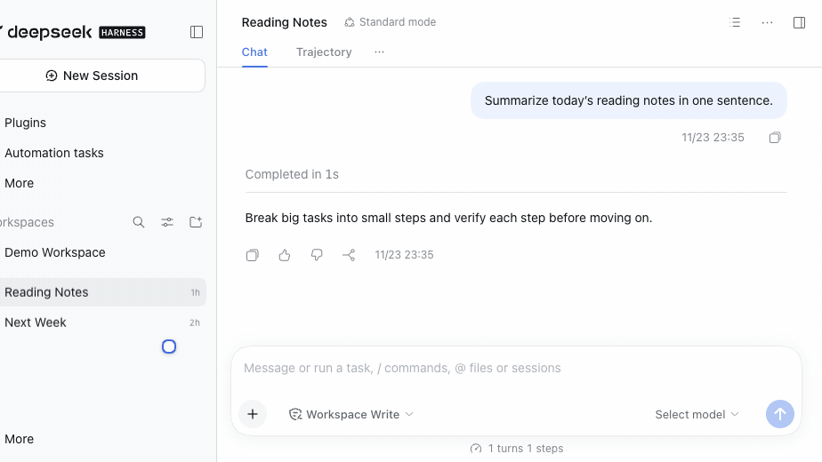

# dsh-session-delete-lite

A minimal DeepSeek Harness (DSH) plugin that only adds a **Delete session** action to the sidebar.

[简体中文](README.zh.md)

## Install

### npm (recommended)

In DSH, open **Plugins → Add plugin** and paste the package name:

```text
dsh-session-delete-lite
```

For CLI installation, use the command below after quitting the desktop app. Change `desktop` to `web` if you use the Web profile.

```bash
dsh plugin --profile desktop add dsh-session-delete-lite
```

To pin a version, use `dsh-session-delete-lite@1.0.2`.

### GitHub

You can also install from the tagged source. In DSH, open **Plugins → Add plugin** and paste:

```text
github:GTilor/dsh-session-delete#v1.0.2
```

Or from the CLI:

```bash
dsh plugin --profile desktop add github:GTilor/dsh-session-delete#v1.0.2
```

You can download the installer and enter its local path in **Add plugin**. [Download the v1.0.2 installer](https://github.com/GTilor/dsh-session-delete/releases/download/v1.0.2/dsh-session-delete-lite-1.0.2.tgz)

## Demo

The demo deletes the open **Reading Notes** session from its sidebar menu. After confirmation, **Next Week** stays in the list and Harness opens a new session in the same workspace.



## What it does

- Adds **Delete session** to every session's `⋯` menu in the sidebar.
- Greys the row out while the session is running or waiting on you.
- Shows the session name in the confirmation dialog so you can check it before choosing **Delete permanently**.
- Shows a green check at the top when the session is deleted. If deletion fails or cleanup is incomplete, an amber notice appears and the dialog keeps the reason visible so you can retry.

Deletion removes the JSONL directory DSH identifies for the session, its workspace-list entry, its projection cache and its spilled tool results. Both default and custom directories are supported. The plugin checks with DSH that the record is gone before reporting success. **Deletion is permanent.**

SQLite stores multiple sessions in a shared database. For those sessions, the dialog explains the storage limitation and preserves both the history and the sidebar entry.

You can delete an idle session from the sidebar even after opening it and switching away. When you delete the session on screen, the view moves to a fresh session in the same workspace.

## Remove

```bash
dsh plugin --profile desktop remove dsh-session-delete-lite
```

## How it works

`index.js` handles `POST /_dsh-session-delete/delete`. `client.js` renders the menu row and the confirm dialog through DSH's `sidebar.workspaces.session.menu.item` and `shell.overlay` slots.

When the desktop or Web UI opens a session, `web-agents.js` keeps the handle DSH provides for closing that session. On confirmation the plugin checks for running tasks and queued user messages, closes the idle session, and acquires exclusive write access to its history. It moves the history outside DSH's session scan before clearing caches, the workspace entry, and the staged files. If cleanup is interrupted, the plugin resumes it the next time DSH starts. The dialog explains when another component or process still holds the session.

Run `npm test` in the project directory to run the regression tests with temporary sessions.

## Requirements

Supports DeepSeek Harness `0.2.2-rc.5` and `^0.2.3-alpha.2`. Deletion of both the current session and a previously opened session was tested end to end in the Web UIs of `0.2.2-rc.5` and `0.2.3-alpha.2`. Desktop and `dsh web` share the sidebar and session controller.

## License

MIT.
