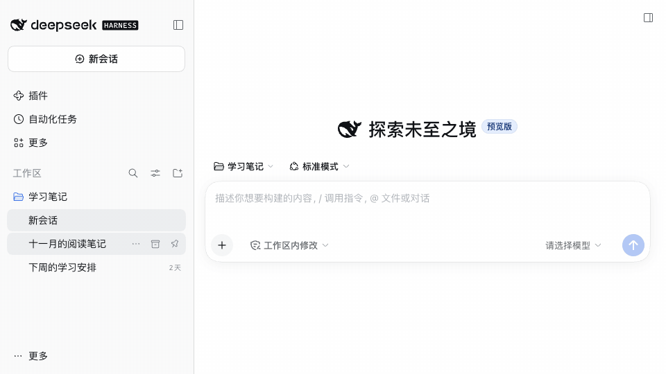

# dsh-session-delete-lite

一个极简的 DeepSeek Harness（DSH）插件，只提供**从侧栏删除会话**的功能。

[English](README.md)

## 安装

在 DSH 打开 **插件 → 添加插件**，粘贴下面的地址。安装并启用后重启 DSH。

```text
github:GTilor/dsh-session-delete#v1.0.1
```

也可以在退出桌面版后用命令行安装。用 Web 版时，把 `desktop` 换成 `web`。

```bash
dsh plugin --profile desktop add github:GTilor/dsh-session-delete#v1.0.1
```

你也可以[下载 .tgz 安装包](https://github.com/GTilor/dsh-session-delete/releases/download/v1.0.1/dsh-session-delete-lite-1.0.1.tgz)，在 **添加插件** 里输入文件的本地路径。



## 功能

- 侧栏每个会话的 `⋯` 菜单里多一项 **删除会话**。
- 会话运行中或等你确认时，该项置灰。
- 弹一次确认框，确认后真删。

删除会清掉 DSH 为该会话指定的 JSONL 目录、列表登记、投影缓存和溢出的工具结果。默认目录和自定义目录都支持。插件会向 DSH 确认会话记录已经消失，再提示成功。**删除后无法恢复。**

SQLite 把多个会话保存在同一个数据库里。遇到这种存储方式，确认框会显示原因，并保留会话和侧栏登记。

如果删的正是你在看的会话，界面会切到同工作区的新会话。如果清理未完成，确认框会显示提示，你可以在同一个框里重试。

## 卸载

```bash
dsh plugin --profile desktop remove dsh-session-delete-lite
```

## 实现

`index.js` 处理 `POST /_dsh-session-delete/delete`。`client.js` 通过 DSH 的 `sidebar.workspaces.session.menu.item` 和 `shell.overlay` 槽位渲染菜单项和确认框。

确认删除时，插件会重新检查 DSH 报告的活动。如果 DSH 的 Agent 仍持有会话，确认框会提示重启 DSH 后重试。其余会话走宿主的卸载流程，再通过工作区服务更新登记并清理文件。

在项目目录运行 `npm test` 即可用临时会话执行回归测试。

## 版本要求

已在 DeepSeek Harness `0.2.2-rc.5` 和 `0.2.3-alpha.2` 的 Web 界面实测。桌面版与 `dsh web` 共用侧栏接口。

## 许可

MIT。
